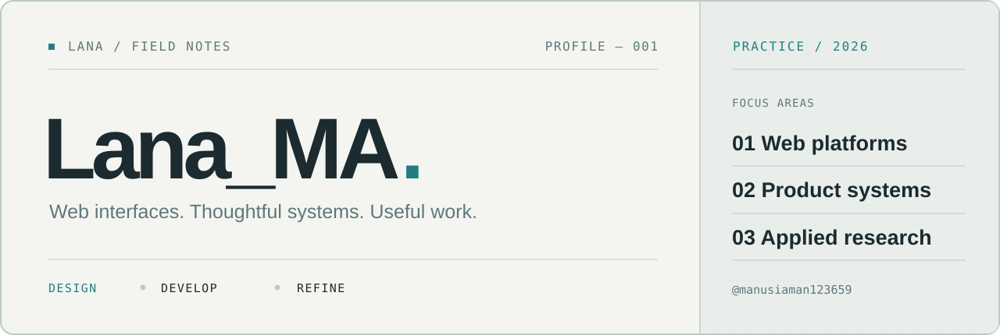

<!--
  Profile repository: github.com/manusiaman123659/manusiaman123659
  Personal identity: Lana_MA
  Intent: quiet, editorial, readable; no third-party stats, fake counters, or animated badges.
-->

<picture>
  <source media="(prefers-color-scheme: dark)" srcset="./assets/cover-dark.svg">
  <source media="(prefers-color-scheme: light)" srcset="./assets/cover-light.svg">
  
</picture>

 

01 / INTRODUCTION

## Hello, I'm Lana_MA.

I build web experiences and enjoy figuring out the systems behind them — from the smallest interface detail to content workflows, data, and deployment.

My approach is simple: **clear structure, useful functionality, and considered design.**

Indonesia · Web development · Learning by building

---

02 / SELECTED WORK

### 01 — Autentik / AKA · Company website

Web development work on a multilingual company website, including content management, interface refinement, and release workflows.

`Next.js` · `TypeScript` · `Supabase`

Professional work · [Public website](https://autentik.co.id/)

### 02 — Personal portfolio · Work in progress

Developing a portfolio with a more distinctive visual language: restrained typography, considered spacing, and purposeful interactions.

`UI engineering` · `React` · `Design exploration`

### 03 — EduQuest · Learning project

A web application project exploring frontend and backend development with structured data and application workflows.

`React` · `TypeScript` · `Prisma` · `PostgreSQL`

<!-- If any project should remain private or should not be publicly credited, edit or remove its entry before publishing. -->

---

03 / TOOLBOX

| Area | Tools & technologies |
| :-- | :-- |
| **Frontend** | `TypeScript` · `JavaScript` · `React` · `Next.js` · `Tailwind CSS` |
| **Backend & data** | `Node.js` · `Supabase` · `PostgreSQL` · `Prisma` |
| **Workflow** | `Git` · `GitHub` · `Figma` · `Vercel` |

---

04 / CURRENT NOTES

- Refining how I build and maintain web interfaces.
- Exploring **RFID-based inventory counting** and how it may connect with enterprise systems.
- Learning to make projects easier to understand, test, and maintain.

---

05 / SAY HELLO

[**GitHub profile**](https://github.com/manusiaman123659) · [**Repositories**](https://github.com/manusiaman123659?tab=repositories)

Carefully made, without animated banners, contribution counters, or third-party stat cards.
